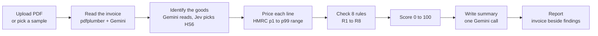

# Sentinel

**Catch trade-based money laundering on the invoice, in seconds.**

Sentinel reads a trade invoice PDF, works out what the goods really are, compares every price with what the UK actually paid for the same goods, and checks eight red-flag rules. A compliance analyst gets a review priority from 0 to 100, a plain-English reason for every flag and a short summary. It ranks invoices for review; it never calls anything fraud.

Live demo: **https://stealth-startup-sotonship.vercel.app** (open the checker from the homepage)

Built in 48 hours at SotonShip 2026 (FinTech track), 16 to 18 October 2026.

---

## Contents

- [Why it matters](#why-it-matters)
- [How it works](#how-it-works)
- [Results](#results)
- [Run it locally](#run-it-locally)
- [Configuration](#configuration)
- [Deploying to Vercel](#deploying-to-vercel)
- [Repository layout](#repository-layout)
- [Data sources](#data-sources)
- [Use of AI](#use-of-ai)
- [Team](#team)

---

## Why it matters

Criminals move money by lying on trade invoices. Goods worth $1,000 are invoiced at $10,000, and the extra $9,000 reaches the seller looking like an ordinary sale. Banks find this hard to catch:

- **There is no easy reference price.** Most goods have no published market price, so staff judge by eye whether a price looks "manifestly unusual".
- **Descriptions are messy.** "MBP 14 M3 16/512" or "HHB M10x50 8.8 ZP" mean nothing to a keyword rule.
- **Checks are manual and sampled.** Existing automated tools are expensive and, according to the ICC, produce false positive rates above 99%.

Sentinel gives every invoice a fast, explained first pass, so analysts spend their time on the invoices most likely to matter.

## How it works



| Step | What happens | Built with |
|---|---|---|
| 1. Read | Extracts parties, origin, ports, currency and every line (description, quantity, unit, price). Every number is checked against the PDF text. | `pdfplumber`, Gemini 2.5 Flash when a key is set |
| 2. Classify | The AI first says in plain words what each line is, then picks the HS6 code chapter by chapter. Lines too vague to identify are left unclassified on purpose. | TypeSafe's Jev via OpenRouter (default), UN Comtrade HS list |
| 3. Price | Converts the price to a common currency and unit, then places it in the spread of real UK import prices for that code (1st to 99th percentile). | HMRC trade databases, Federal Reserve exchange rates |
| 4. Rules | Runs eight checks (table below). Thresholds live in one file, `backend/tbml/rules/config.yaml`. | Python |
| 5. Score | Adds up flag weights (high 40, medium 15, low 5), capped at 100. **Review now** at 60+, **Review** at 25+, else **Low**. | Python |
| 6. Summarise | One model call writes a one or two sentence summary after the rules have run. Cached, so a re-check costs nothing. | Gemini via OpenRouter |

### The eight rules

| Rule | Flags when |
|---|---|
| R1 Price outlier | A unit price falls outside the normal range for that product |
| R2 Quantity vs value | The quantity or weight cannot match the value invoiced |
| R3 Vague description | Wording like "goods as per contract" hides what is shipped |
| R4 Wrong origin | The stated origin does not fit the route or the seller |
| R5 Odd route | Goods take a route that makes no economic sense |
| R6 Maths wrong | Line totals or the invoice total do not add up |
| R7 Home address | A large shipment is going to a private residence |
| R8 Low confidence | The system could not read or classify a line reliably |

The AI steps only read and classify. Pricing, rules and scoring are plain code, so every flag can be traced and audited.

## Results

Run `make eval` to reproduce. It writes `reports/eval/summary.md`.

| Test | Result |
|---|---|
| Classifying 39 realistic invoice lines | AI classifier 37 to 39 correct across runs, keyword baseline 26 |
| Vague lines correctly left unclassified | 5 of 5 |
| Problem invoices flagged (of 18) | 17 |
| Clean or legitimate-but-unusual invoices flagged (of 42) | 0 |
| Anomalies caught by reviewing the top 20% | 67%, vs 20% for random spot checks |

> **Honest caveat:** the 60 test invoices and their problems were generated by our own code, so these numbers show the system works as designed, not real-world accuracy.

## Run it locally

You need Python 3.11+, Node 18+ and `make`.

```bash
make setup        # create .venv and install the backend with dev tools
make api          # backend on http://127.0.0.1:8000
make web          # website on http://localhost:3000 (in a second terminal)
```

Then open http://localhost:3000/app/checker, pick a sample invoice and press **Check sample**.

Without an API key everything still runs offline: the classifier falls back to keyword matching and the summary uses a template.

| Command | What it does |
|---|---|
| `make test` | run the test suite |
| `make lint` / `make format` | check / fix code style (ruff) |
| `make eval` | run the evaluation above |
| `make synthetic` | regenerate the 60 test invoices (`SEED=42 N=60`) |
| `make data` | rebuild the price bands from raw HMRC data |

**API endpoints** (served under `/api` when deployed):

| Endpoint | Purpose |
|---|---|
| `GET /health` | status, price data and model in use, deployed commit |
| `POST /check` | check an uploaded PDF (multipart field `file`) |
| `GET /samples`, `POST /samples/{id}/check` | list and check the bundled test invoices |
| `GET /samples/{id}/pdf` | the sample's PDF |
| `GET /reports/{id}` | a report checked earlier |
| `GET /hs?codes=...` | HS chapter, heading and CN8 names for up to 100 codes |

## Configuration

Copy `.env.example` to `.env`. **Never commit `.env`.**

| Variable | Purpose |
|---|---|
| `OPENROUTER_API_KEY` | turns on the AI steps |
| `OPENROUTER_MODEL` | chat model, e.g. `google/gemini-2.5-flash` |
| `JEV_MODEL` | HS classifier model, default `typesafe/jev-1.14` |
| `CLASSIFIER` | `jev` (default), `hierarchical`, `flat` or `keyword` |
| `SUMMARY_MODEL` | optional smaller model for the summary |

## Deploying to Vercel

`vercel.json` deploys the repo as one Vercel project with two services on one domain:

| Service | Folder | Serves |
|---|---|---|
| `backend` (FastAPI, `tbml/asgi.py`) | `backend/` | `/api/*` |
| `web` (Next.js 15) | `web/` | everything else |

Set the variables above in the Vercel project for **Production**, then redeploy. Check `/api/health`: it should report the real price data, the model and the deployed commit.

Good to know:

- The backend build copies `data/` into the bundle and compresses the price databases to fit Vercel's size cap. They unpack into the temp dir on first use.
- The deployed disk is read-only, so caches and saved reports go to the temp dir and last only as long as the function instance.
- Background on these choices is in `DECISIONS.md` (DV1 to DV5).

## Repository layout

```
backend/tbml/
  extract/      PDF to invoice
  classify/     HS classification (Jev, chat model, keyword baseline)
  benchmark/    price lookups in the HMRC databases
  rules/        the eight rules + config.yaml
  score/        priority score
  summary.py    the AI summary
  pipeline.py   runs every stage; api.py serves it
backend/scripts/  evaluation, invoice generator, data builders
web/              Next.js website and checker
data/
  databases/    HMRC price databases, one SQLite file per HS chapter
  reference/    HS code list, exchange rates, unit weights
  synthetic/    the 60 labelled test invoices
  cache/        cached model answers, so demos and evals reproduce
docs/             architecture notes
```

`plan.md` is the original build plan, `DECISIONS.md` logs every change to it, and `PROGRESS.md` logs the work.

## Data sources

| Data | Source | Licence |
|---|---|---|
| Price databases (`data/databases/`) | HMRC Overseas Trade Statistics, UK imports of every commodity code, July 2023 to August 2026 | [Open Government Licence v3.0](https://www.nationalarchives.gov.uk/doc/open-government-licence/version/3/) |
| Fallback price bands (`data/benchmarks/`) | HMRC Overseas Trade Statistics via the uktradeinfo API, 7 goods, 2023 to 2025 | Open Government Licence v3.0 |
| HS code list (`data/reference/hs.db`) | UN Comtrade reference list (Combined HS) | UN Comtrade terms of use |
| Exchange rates | US Federal Reserve G.5A annual averages, 2022 to 2025; AED from the UAE central bank peg | Public domain |
| Screw unit weights | Calculated from steel density and bolt size, working shown in the file | Ours |
| Test invoices (`data/synthetic/`) | Generated by us; every company, person and address is fictional and each PDF is marked "SYNTHETIC TEST DOCUMENT" | Ours |

No real customer data is used anywhere. HMRC figures can be revised for up to 18 months.

## Use of AI

- **In the product:** OpenRouter runs three steps: reading the invoice (Gemini 2.5 Flash), classifying goods (TypeSafe's Jev, with Gemini reading the line first) and writing the summary (Gemini). Every answer is cached in `data/cache/`, so demos and evaluations reproduce without a key. The rules and score never depend on AI output alone, and AI text is shown as an aid for the analyst, not a verdict.
- **In building it:** much of the code was written with AI coding assistants (Claude Code and Claude), directed, reviewed and tested by the team. Those commits carry a `Co-Authored-By` trailer.

## Team

| Name | Main contributions |
|---|---|
| **Kalash Kharel** | Backend pipeline, website, Vercel deployment, HMRC price databases |
| **Ali Murat Keceli** | Full HS code list, Jev classifier integration, report summary, website redesign |
| **Arqam Khalid Qeisi** | Three-step AI classifier, OpenRouter integration, real prices and exchange rates, evaluation, checker page |
| **Anveet Bhusal** | Trade data research and HMRC data fetching |

The repository was created after hacking opened at SotonShip 2026.
